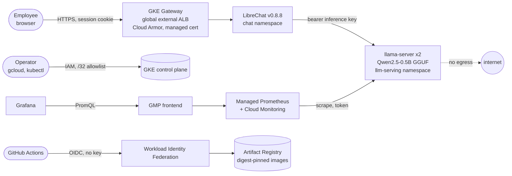
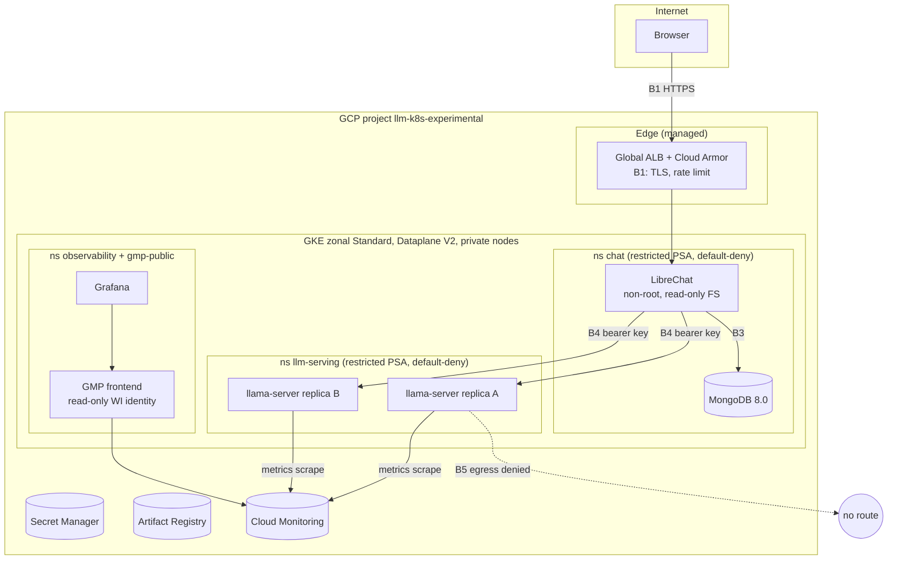
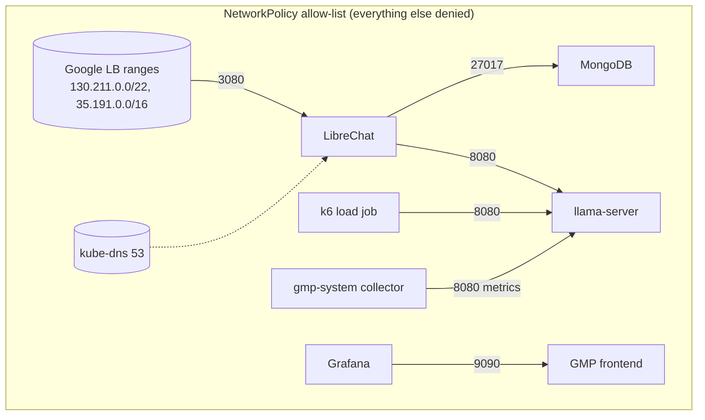
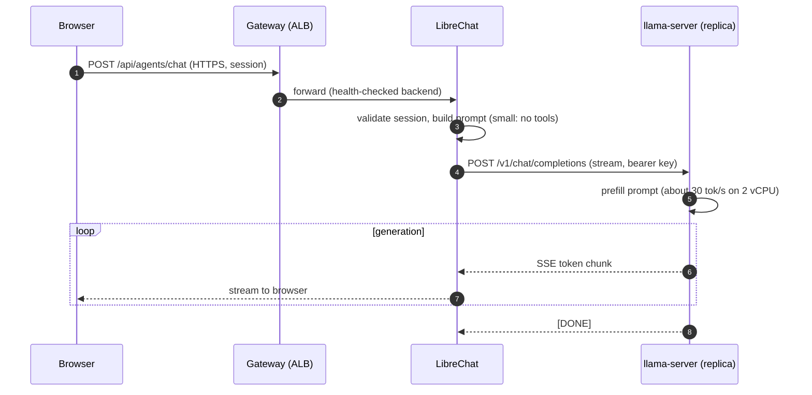
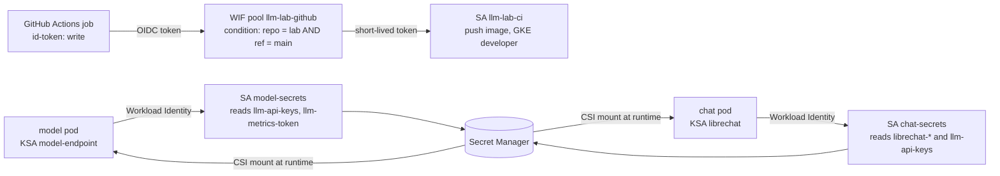
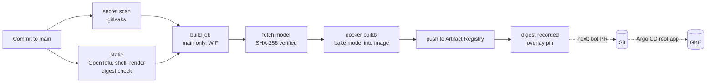
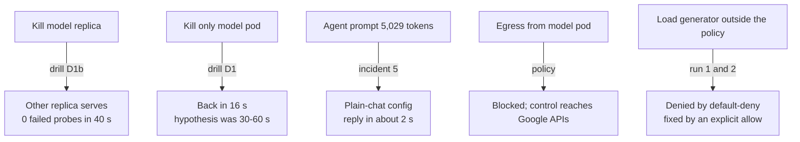

# Architecture diagrams (Mermaid)

Sources for the article figures. They render on GitHub. Keep each diagram in sync with the manifests it describes; the file paths in each section say where the truth lives.

## 1. System context

## 2. Containers and trust boundaries

Boundaries follow [docs/THREAT_MODEL.md](../THREAT_MODEL.md): B1 edge, B2 edge to chat, B3 chat to database, B4 chat to model, B5 model egress, B6 cross-namespace, B7 operator to cluster, B8 build to runtime.

## 3. Deployment and network policy topology

## 4. Request sequence: one message, browser to tokens

## 5. Identity and secret flow (no static keys)

Status: the identities and grants exist; the CSI mounts are not wired yet, because the secret values have not been synced (see the article plan, section 4). Until then the workloads still use Kubernetes Secrets created by scripts.

## 6. Delivery pipeline

Status: CI up to the build is running and green. Argo CD sync is designed (`gitops/`) and not installed.

## 7. Failure and recovery view

